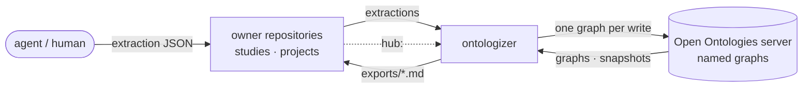
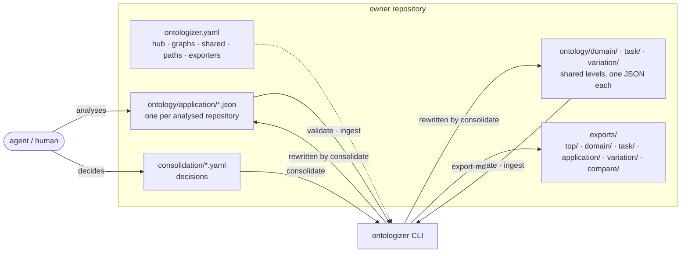
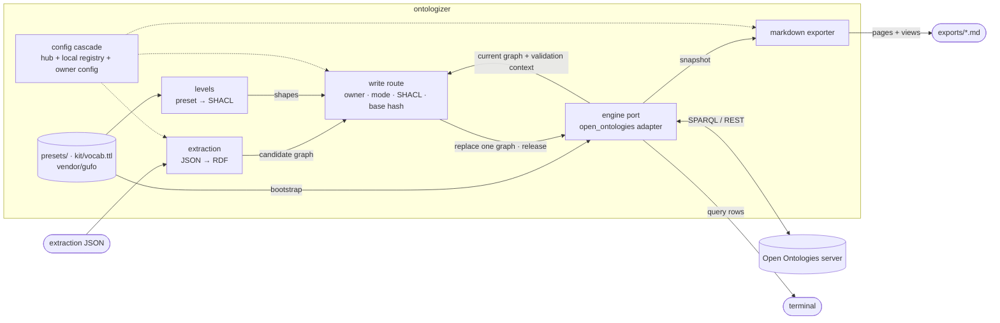

# ontologizer

A toolkit for building ontologies of software projects and using them well. Agents analyse source code and documentation; the kit turns their findings into a standard RDF/OWL ontology. Every concept sits on a level, and every claim carries evidence from the source. The ontology lives in a shared Open Ontologies store ([what the kit relies on](docs/open-ontologies.md)), where people and agents query it, check their own concepts and designs against it, keep their answers within its vocabulary, and compare projects and releases.

## What it does

- **Build.** A staged analysis process turns a corpus of repositories into an ontology: inventory, double extraction, reconciliation, mapping onto shared concepts, consolidation and verification, each stage with a gate and metrics ([`docs/process.md`](docs/process.md)).
- **Validate and version.** Every write is checked with SHACL and replaces exactly one named graph. Releases freeze a set of graphs as an immutable version with its own term IRIs.
- **Use.** SPARQL over the store (`ontologizer query`), and the agent skill [`query-ontology`](skills/query-ontology/SKILL.md) for exploring and reasoning over the ontology, checking a concept against it, and answering only in its terms. Generated markdown (`exports/`) is there for reading.
- **Compare.** Built on finished ontologies: concept and variation matrices across projects, release-to-release comparison by meaning, and the overlay of a new project onto a released model.

## Levels

Concepts are placed on the four levels of Guarino (FOIS 1998):

1. **Top**: the most general categories (kind, role, phase, event, relator, quality, …). These are not authored here; they come from an existing upper ontology, as is common practice. The kit uses [gUFO](http://purl.org/nemo/doc/gufo) 1.0.0, the OWL implementation of the Unified Foundational Ontology, vendored and pinned. Every concept is typed with a gUFO meta-type.
2. **Domain**: the concepts of a subject area, shared by many projects (for example, a user, a repository or a build).
3. **Task**: shared activities and processes (for example, reviewing a change or deploying a release), independent of a particular project.
4. **Application**: the concepts of one project, each mapped to domain and task concepts as an equivalence, a specialization, a role, a realization or a partial overlap.

Beside the levels runs a second axis, **variation**: the design dimensions on which projects differ, and the value each project chose. The levels, the allowed mappings between them and the accepted upper categories are data in a preset ([`presets/guarino-4.yaml`](presets/guarino-4.yaml)), not code.

## Standards

The ontology is plain W3C RDF throughout, so any RDF tool can read it:

| Standard | How the kit uses it |
| --- | --- |
| **RDF 1.1**, named graphs | Each part of the ontology (a shared level, a project, a release) is one named graph, `urn:ontologizer:graph:<path>`. Turtle for releases and pinned sources, N-Triples on the wire |
| **OWL 2 / RDFS** | Concepts are `owl:Class` with `rdfs:subClassOf` hierarchies; the kit vocabulary (`kit/vocab.ttl`) declares its classes and properties in OWL with RDFS domains and ranges |
| **SKOS** | `skos:prefLabel`, `skos:altLabel` (synonyms and each project's own names) and `skos:definition` on every concept; variation dimensions are `skos:ConceptScheme`s and their values `skos:inScheme` |
| **SHACL** | Shapes are generated from the level preset: core constraints plus SHACL-SPARQL rules (which mapping kinds may link which levels, that a mapping target exists, that a disputed claim keeps both readings). Every write is validated against the graph and its validation context before it reaches the store |
| **SPARQL 1.1** | Query for every read (`query`, exports, the `query-ontology` skill); Update for writes, where one request replaces one graph in one transaction |
| **PROV-O** | Evidence nodes are `prov:Entity`, and `ok:evidence` is a sub-property of `prov:wasDerivedFrom` |
| **Dublin Core Terms** | `dcterms:isVersionOf` links a release term to its working term |
| **gUFO (UFO)** | The top level and the meta-type of every concept |

## How it works

Agents never write RDF. They produce extraction JSON. The kit converts it to RDF deterministically, validates it with SHACL generated from the level preset, and writes it through a single route, one graph at a time.

This repository holds only the tool. Each study or project ontology is kept in its own repository: data plus an `ontologizer.yaml` that points back here.

## Architecture

Three views, from outside in. On every diagram, solid arrows carry data and dotted arrows carry configuration.

### System



- Several owner repositories share one store. Each owns its own graphs, and the kit owns `upper/gufo`, `kit/core` and `inferred/*`.
- **Ownership.** Every config knows the owner of every graph, and a literal pattern wins over a glob. A config writes and releases only the graphs it owns. Its export has pages only for those graphs; graphs of other owners can feed its views through `context:`.
- **Why one route.** The engine's whole-dataset operations replace every graph: `onto_load(path)`, `onto_plan`/`onto_apply`, `onto_rollback` and `onto_clear` (see [`docs/open-ontologies.md`](docs/open-ontologies.md#verified-behaviour)). The kit never calls them. It writes one graph per request.

### Owner repository



- A study keeps `ontologizer.yaml` at its root. A project that maps itself keeps it at `onto/`.
- **The ontology itself lives under `ontology/`**, one directory per level, as extraction JSON. The kit converts it to RDF and writes it to the store; the JSON and the store's working graphs are one ontology in two forms. Released versions are additionally kept as Turtle copies (`releases/`, by `export-graph --turtle`), and `exports/` is generated markdown for reading. Run directories (`runs/<run>/`) hold the working record of the analysis process.
- **One directory per level**, in the ontology and in the export alike:

  | Level | Input (`paths:` default) | Export page |
  | --- | --- | --- |
  | top | — (the kit's gUFO) | `exports/top/gufo.md`: categories in use, with the concepts under each |
  | domain | `ontology/domain/<scope>.json` | `exports/domain/<scope>.md` |
  | task | `ontology/task/<scope>.json` | `exports/task/<scope>.md` |
  | application | `ontology/application/<project>.json` | `exports/application/<project>.md` |
  | variation (second axis, not a level) | `ontology/variation/<scope>.json` | `exports/variation/<scope>.md` |

  The level of a graph comes from its `role` through the preset. A page is named after the graph's last path segment, or its first one when the last only repeats the level (`my-study/domain` → `domain/my-study.md`). Cross-level comparisons go to `exports/compare/`, the index to `exports/README.md`. Only owned graphs get pages, so a project that maps itself has `application/` and no shared levels.
- Decision files (`consolidation/*.yaml`) are passed to `consolidate` explicitly; `exports/` is the exporter's `out`.
- The config sets `hub:` and declares:
  - its graphs and their write modes;
  - `shared:`, which maps extraction prefixes such as `domain:` to the graphs that hold the shared levels;
  - its validation context, paths, exporters and evidence sources.
- The hub finds owners through its per-machine registry `ontologizer.local.yaml`, which is gitignored.

### Inside the kit



- **Write path:** JSON → RDF → write route → one graph on the server. Before writing, the route reads the current graph and its validation context back, for local SHACL (pyshacl, pyoxigraph) and the base-hash check.
- **Read paths:** one snapshot of all graphs → markdown exporter → `exports/` in the owner repository. `query` prints its rows to the terminal.
- **Hub config.** `ontologizer.yaml` sets the store, the IRI namespace (`urn:ontologizer:`), the level preset and the kit's own graphs.
- **Write modes:**
  - `research`: free writes, checked by SHACL;
  - `strict`: changes go through review;
  - `import-only`: a pinned source with a sha256;
  - `engine-only`: written by the engine;
  - `@ver`: an immutable release, with version-distinct term IRIs.

## Install

You need:
- Python 3.14 and [uv](https://docs.astral.sh/uv/);
- an Open Ontologies v2.1.0 server at `http://127.0.0.1:8080` (`store.url`) with persistent storage; see [Server setup](docs/open-ontologies.md#server-setup). Without one, `make oo-server` clones, builds and starts it in Docker and writes the token to `.env` ([details](deps/open-ontologies/README.md)).

```sh
git clone https://github.com/tohachan/ontologizer.git && cd ontologizer
uv sync
cp .env.example .env                                  # set OPEN_ONTOLOGIES_TOKEN; .env is gitignored
make oo-status                                        # is there an engine clone and a running server?
make oo-server                                        # start one if not; a running server is left as it is
cp ontologizer.local.yaml.example ontologizer.local.yaml   # register your owner repositories
scripts/oo curl api/stats                             # checks the token and the server without printing the token
uv run ontologizer bootstrap                          # imports upper/gufo and kit/core; safe to re-run
uv run pytest                                         # hermetic tests, no server needed
```

`scripts/oo` reads the token from the first of these that has it:
1. `.env` in the current checkout;
2. `.env` in the main checkout, when running in a git worktree;
3. the environment.

## Use

Run the kit from an owner's directory. Without `--config`, the CLI uses `$ONTOLOGIZER_CONFIG` if set. Otherwise it takes the nearest `onto/ontologizer.yaml` or `ontologizer.yaml`, searching from the working directory upwards. `$ONTOLOGIZER_HUB` overrides the owner's `hub:` setting.

```sh
cd ../my-study
uv run --project ../ontologizer ontologizer status                       # config side, graphs, modes, owners, sizes
uv run --project ../ontologizer ontologizer validate ontology/application/x.json  # schema + SHACL, no write
uv run --project ../ontologizer ontologizer ingest ontology/application/x.json
uv run --project ../ontologizer ontologizer export-md                    # → exports/
```

| Command | Does |
| --- | --- |
| `status` | Shows the loaded config and every graph's mode, owner and size |
| `bootstrap` | Imports the pinned `upper/gufo` and `kit/core` |
| `validate FILE.json` / `ingest FILE.json [--dry-run]` | Checks the extraction against the schema and SHACL. `ingest` then writes it to its graph |
| `export-graph PATH [--turtle]` / `import-graph PATH FILE.ttl` | Copies one graph out of the store / replaces one graph from a file. A file with none of the kit's vocabulary is refused in a graph with a role: the kit would see nothing in it |
| `release PATH … VER` | Releases a set of research graphs as one immutable version `PATH@VER`. Release terms get their own IRIs (`…<path>@<ver>:<id>`, linked to the working term by `dcterms:isVersionOf`), and references inside the set follow them, so versions never mix in queries or reasoning; a reference to a working graph with no release at that version is refused. `release --migrate-iris VER` rewrites releases made before this rule |
| `export-md` | Writes markdown for the owned graphs plus comparison views; the output is deterministic |
| `query FILE.rq` / `query 'SPARQL'` | Runs a SPARQL SELECT over the store and prints one row per line |
| `consolidation-report` / `consolidate FILE.yaml` | Reports what the extractions say about the shared levels / applies a decision file to the shared-level and application files |

### Using an ontology

Once an ontology is in the store, it answers questions:

- **SPARQL.** `ontologizer query` runs a SELECT over all graphs; the store's REST endpoint takes SELECT, ASK and CONSTRUCT ([`docs/open-ontologies.md`](docs/open-ontologies.md)).
- **Agents.** The skill [`query-ontology`](skills/query-ontology/SKILL.md) works in three modes: explore and reason over the concepts, relations, levels, mappings and evidence; check the user's own concept against the store and give a verdict in the kit's mapping kinds (equivalence, specialization, role, realization, partial, absent); answer, write or review a text using only the ontology's vocabulary, listing what falls outside it. It only reads, uses the working graphs unless a release is asked for, and names the slice and the analysed commits in every answer. Tested query patterns are in [`references/queries.md`](skills/query-ontology/references/queries.md).
- **Reading.** `export-md` writes one page per level and project, plus `exports/compare/`: the concept matrix (shared concept × project) and the variation matrix (dimension × project).
- **Comparing.** `report` ranks the projects against a study's design targets (a fit matrix of requirements × projects, with the concepts to reuse). `release-compare A B` compares two releases by meaning: which concepts were kept, renamed, split, merged, added or dropped, and why. `report --compare A B` compares two runs. Stage 9 maps a new project onto a released model and shows what it realizes and what it lacks.

### The analysis process

A corpus is analysed in stages, each with a gate and metrics: [`docs/process.md`](docs/process.md). Stage 0 frames the study (skill [`frame-study`](skills/frame-study/SKILL.md)); stages 1–9 are run by the skill [`analyse-corpus`](skills/analyse-corpus/SKILL.md).

| Stage | Commands |
| --- | --- |
| 0 frame | `frame init`, `frame check`, `gate approve frame --by NAME` |
| 1 inventory | `inventory [PROJECT…] [--rebuild-stale]` |
| 2 double extraction | `brief extract PROJECT --extractor ID [--parts N]` |
| 3 reconciliation | `reconcile PROJECT [--apply]` |
| 4 mapping | `map PROJECT [--apply]` |
| 5 consolidation | `group`, then `consolidate consolidation/<run>.yaml` |
| 6 verification | `verify PROJECT [--apply]` |
| 7 stability and report | `stability`, `report`, `report --compare A B`, `release-compare A B [--run-a ID]` |
| 8 review and calibration | `review build`, `review apply --by MODEL --effort E`, `gold sample NAME`, `gold calibrate FILE`; review and gold labels by a strong agent, not people |
| 9 overlay | in the target owner's config with `process.overlay: true`: stages 2–4 and 6 on the target, then `overlay [--previous FILE --compare FILE]` |
| 10 update | a new run for the source or correction, then `update-check BASE --base-run RUN`, `release-compare BASE working`, `review build --since RUN` |

Narrow decisions (same concept? which category? do these lines support the claim?) go through the decision port, stage by stage in mode `jev`, `llm` or `off`. Every decision is logged in the run directory. Cross-harness runs (e.g. Codex) exchange files only: [`docs/cross-harness.md`](docs/cross-harness.md).

### A topic that grows from any sources

An ontology need not start from a corpus of code. A topic can start from one description, model or set of notes, and improve with each new source or correction: `admission_families: 1` in the frame lets a concept enter the shared levels from one source, and it stays a hypothesis until an independent source confirms it. Each update is a new run, held to the last release by `update-check` (blocks on removals without a reason, a changed concept its evidence does not support, a question that lost its answer, a new clash), which needs no new source. Set `process.update_check: true` to make `release` require it. Details: [`docs/process.md`](docs/process.md) §10.

### Adapters

Evidence, inventory and decisions go through ports. An owner's config picks the adapter of each port by name. All adapters are optional: a config that names none still runs every stage on its deterministic or `llm` path.

Built in (each is used only when a config names it; none needs a package beyond the kit's own):

| Port | Name | Reads | Config |
| --- | --- | --- | --- |
| evidence | `checkout` | plain git checkouts `<root>/<repo>` | `evidence: [{adapter: checkout, root: ../sources}]` |
| inventory | `graphify` | an existing Graphify `graph.json` per repository: type nodes and CLI entry points with file, line, module and degree | `inventory: {adapter: graphify, graphs: {acme: ../graphs/acme/graph.json}}` or `{adapter: graphify, pattern: ../graphs/{repo}/graph.json, metadata: ../graphs/{repo}/metadata.json}`; optional `max_candidates` |
| inventory | `rdf` | the classes and SKOS concepts of an RDF file in a source checkout | `inventory: {adapter: rdf, root: ../sources, files: {acme: model.ttl}, format: turtle}`; `format` when the suffix does not tell it |
| decisions | `jev` | Jev through OpenRouter's Decisions API (alpha) | `decisions: {adapter: jev, model: typesafe/jev-1.13}`; the key is `OPENROUTER_API_KEY` from the environment or `.env` (owner, then the kit), never printed |

**More adapters from a package.** The kit resolves names through entry points (`ontologizer.evidence`, `ontologizer.inventory`, `ontologizer.decisions`), so any installed package that declares them adds adapters without a change to the kit:

```sh
uv run --project ../ontologizer --with my-adapters ontologizer …              # from an index
uv run --project ../ontologizer --with-editable ../my-adapters ontologizer …  # a local checkout
```

A config that names an adapter no installed package provides fails with a message naming it.

**Writing one.** A package declares a factory per adapter and implements the port's protocol (`src/ontologizer/ports/`):

```toml
[project.entry-points."ontologizer.inventory"]
my-index = "my_adapters.index:factory"     # factory(conf: dict, *, base: Path) -> InventorySource
```

`conf` is the config entry without `adapter`, and `base` is the owner config's directory. To change only where graphs come from, or to add freshness and `rebuild` (used by `inventory --rebuild-stale`), subclass `ontologizer.adapters.inventory.graphify.Graphify` and register it under a new name.

### A new study or project

1. Create its `ontologizer.yaml`: at the repository root for a study, at `<repo>/onto/` for a project that maps itself.

   ```yaml
   hub: ../ontologizer
   project: my-study
   graphs:
     - { pattern: my-study/domain, mode: research, role: domain }
     - { pattern: my-study/task, mode: research, role: task }
     - { pattern: projects/*, mode: research, role: project }
   shared: { domain: my-study/domain, task: my-study/task }
   validation_context:
     project: [kit/core, upper/gufo, my-study/domain, my-study/task]
   # paths: { domain: ontology/domain, task: ontology/task, application: ontology/application }   # the defaults
   exporters:
     - { adapter: markdown, out: exports, graphs: ["my-study/*", "projects/*"], context: ["upper/*", "kit/*"] }
   ```

2. Register it in `ontologizer.local.yaml` under `projects:`.
3. Frame the study with the [`frame-study`](skills/frame-study/SKILL.md) skill, then analyse its repositories with [`analyse-corpus`](skills/analyse-corpus/SKILL.md). A single repository mapped onto an existing release is the overlay run (stage 9).

## Layout

| Path | Content |
| --- | --- |
| `src/ontologizer/core/` | Config cascade, levels and SHACL generation, extraction schema and converter, write route, consolidation; the process stages (`frame`, `inventory`, `brief`, `reconcile`, `mapping`, `grouping`, `verify`, `report`, `review`, `update_check`), runs and decisions (`run`), adapter loading (`plugins`) |
| `src/ontologizer/ports/` | Engine, exporter, evidence, inventory and decision ports |
| `src/ontologizer/adapters/` | Open Ontologies engine adapter, markdown exporter, built-in `checkout` evidence, `graphify` and `rdf` inventory and `jev` decision adapters |
| `templates/` | `frame.md` (stage 0) and the extraction briefs, one for a system's source and one for a description (stage 2) |
| `presets/` | Level presets as data (`guarino-4.yaml`) |
| `kit/vocab.ttl`, `vendor/` | Kit vocabulary (`ok:`), pinned gUFO 1.0.0 |
| `skills/` | `frame-study` (stage 0), `analyse-corpus` (stages 1–9, release comparison, ablation), `map-repo` (superseded by the staged process; kept as the record of the first run), `query-ontology` (read-only: explore the store, check a concept against it, answer within its vocabulary) |
| `scripts/oo`, `scripts/engine_check.py` | Engine access helper, engine contract check |
| `Makefile`, `deps/open-ontologies/` | Local engine server: Docker build from a clone, config (`defaults.conf`, gitignored `local.conf`) |
| `docs/open-ontologies.md` | What the kit relies on in the engine: setup, verified behaviour, rules, backup |
| `docs/process.md`, `docs/cross-harness.md` | The analysis process: stages, gates, model roles, metrics; cross-harness runs |
| `ontologizer.local.yaml`, `var/`, `shapes/`, `oo/` | Gitignored: owner registry, operations log, reference SHACL, default engine clone |

Agent instructions: [`AGENTS.md`](AGENTS.md).

## License

Apache License 2.0 ([`LICENSE`](LICENSE)). The vendored gUFO ontology (`vendor/gufo-1.0.0.ttl`) is CC BY 4.0; see [`NOTICE`](NOTICE).
